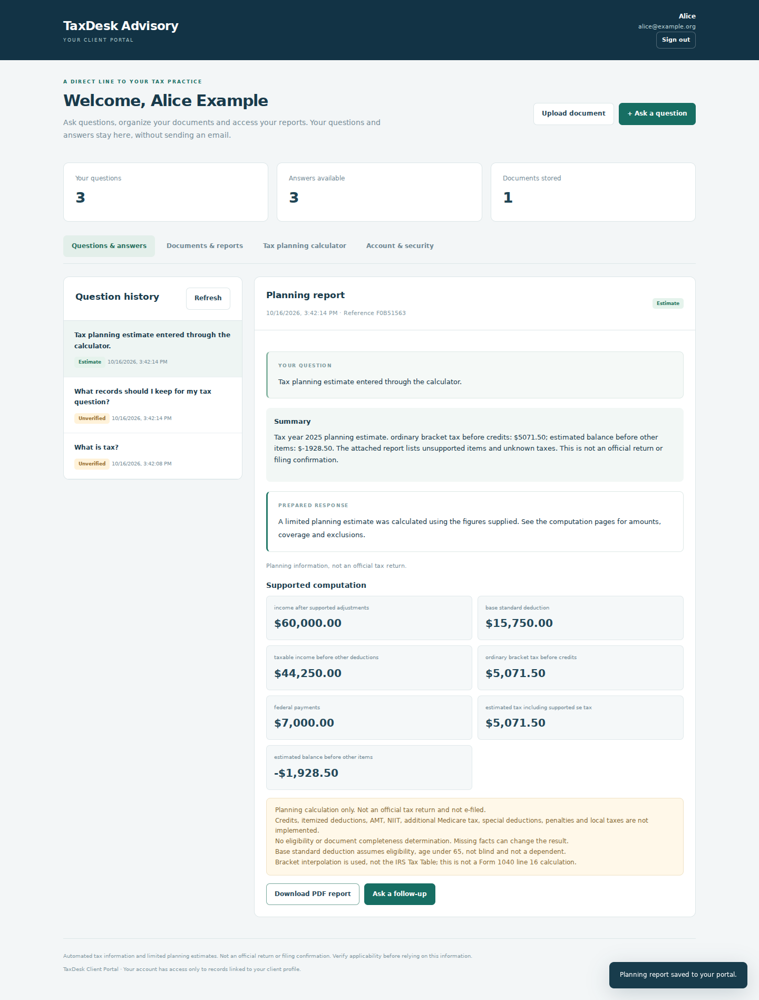
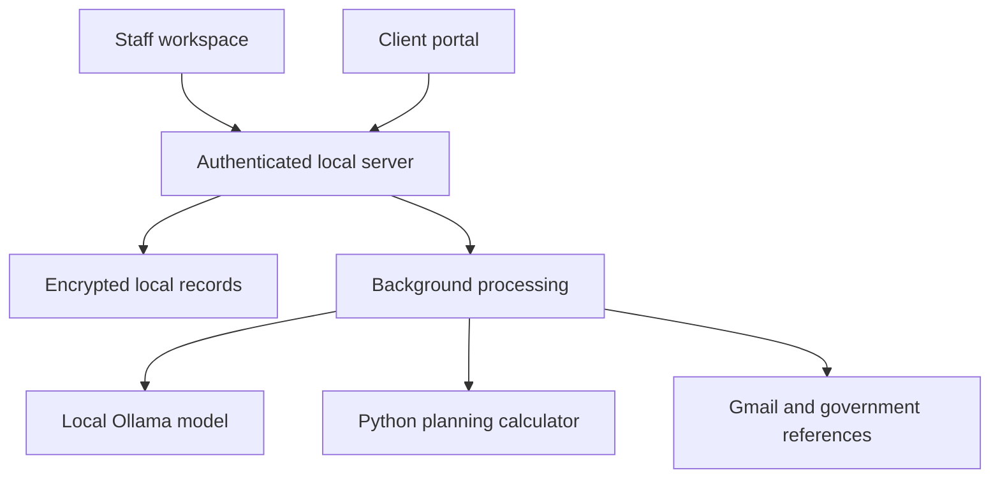
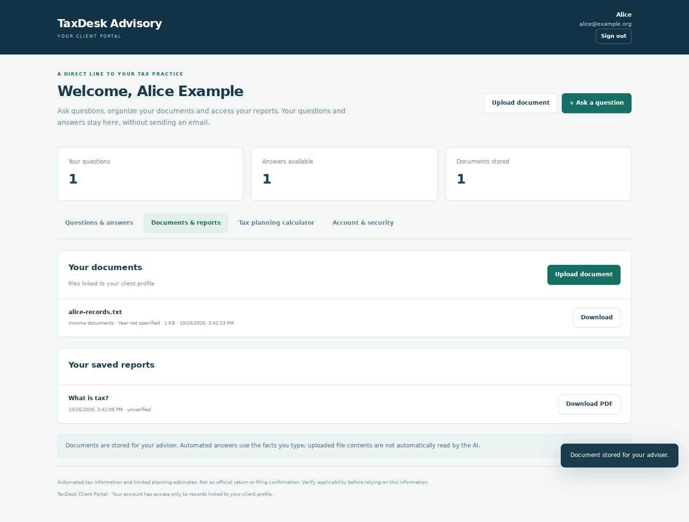
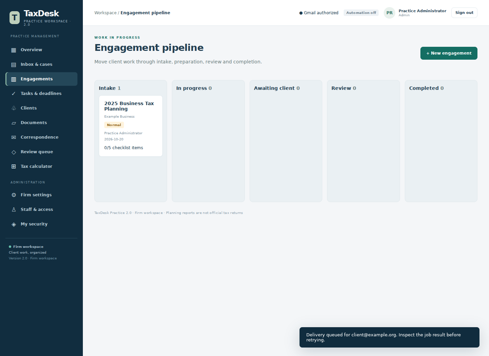

# TaxDesk
### AI-assisted tax information, planning and practice management

**A working local prototype by Crispen Chachengwa**

TaxDesk explores how accounting workflows can connect local AI models, selected Python tax calculations, client communication and document organization in one application.

> **Portfolio showcase only. Application source code is private and is not included in this repository. A demonstration is available upon request.**

*Interface screenshot from a controlled client-portal test. All displayed client identities, addresses and financial figures are fictional. AI responses in these browser tests used controlled model outputs.*

## The problem

Tax questions, client records, follow-ups and reports often arrive through separate channels. TaxDesk brings those steps into a local workflow where staff can track a request, prepare an answer or supported estimate, and retain the related records.

## What the prototype does

| Area | Implemented capability |
| --- | --- |
| Client portal | Client login, in-app questions, answer history, linked follow-ups and report downloads |
| Document storage | Uploads, categories, tax-year labels, profile ownership checks and adviser access |
| AI assistance | Local Ollama models, structured responses and optional source/verification workflows |
| Tax planning | Selected individual and business planning calculations implemented in Python |
| Communication | Gmail OAuth, permitted senders, configurable automatic replies and duplicate protection |
| Reporting | Branded PDFs, aligned computation tables and archived confirmed email deliveries |
| Practice operations | Client profiles, engagement stages, tasks, owners, deadlines and staff reviews |
| Account controls | Staff roles, isolated client views, optional authenticator MFA and expiring sessions |

Uploaded files are stored for advisers. The current prototype does **not** automatically read document contents or perform OCR. Follow-up requests link to earlier questions; they do not automatically send the entire previous conversation to the model.

## Technology

**Python · Ollama · Gmail API · SQLite · Fernet encryption · ReportLab · HTML/CSS/JavaScript**

The language model produces explanatory text. A separate Python calculator computes supported planning figures. The application controls recipient selection, account access, record ownership and email delivery.

## Architecture

The deployed prototype is local. An online portal with a PC-based processing worker is a proposed next phase and has not been implemented.

## Interface tour

### Client documents

Clients upload records into their own profile and can link them to questions for their adviser.

### Engagement management

Staff organize work through intake, preparation, awaiting-client, review and completion stages.

*These screenshots show practice and portal test builds. They demonstrate the interface, not tax accuracy or live model performance.*

## Validation

The version 2.2 development build passed **192 automated tests**. Coverage includes:

- Selected tax calculations and input validation.
- Routing, model output schemas and answer-first response behavior.
- Passwords, session expiry/revocation, optional MFA and request security.
- Client ownership checks for questions, files and reports.
- Denial of staff APIs to client accounts.
- Configurable email reply caps and duplicate-send protection.
- PDF content, recurring headers and page numbering.

Browser checks exercised client questions, uploads, follow-ups, calculator reports, PDF downloads, staff account provisioning and staff replies. Those checks used controlled model outputs and mocked email sending. They are **not** an independent security audit, a tax-accuracy benchmark or evidence of production-scale use.

See [validation notes](docs/VALIDATION.md) for the evidence boundary and [demo walkthrough](docs/DEMO.md) for a suggested demonstration.

## Engineering lessons

- A deterministic rule can falsely route a question when it matches words without understanding their context.
- An answer-generation failure and an email-delivery restriction need distinct diagnostics.
- Model-written text should remain separate from numerical calculations and delivery permissions.
- Client isolation must be enforced by the backend for every record lookup, not only by hiding interface controls.
- Windows and Linux can use different default text encodings; explicit UTF-8 handling prevents template-loading errors.
- Preventing duplicate delivery requires recording a send claim before contacting Gmail and retaining uncertain outcomes.

## Current boundaries

TaxDesk is a local prototype, not a complete tax preparation or e-filing service. It implements selected planning calculations and does not cover all federal returns, states, credits or special situations. AI answers may be incorrect or outdated, particularly when optional evidence checks are disabled. The project is not presented as IRS-approved, independently certified or production ready.

The encryption key and database reside on the local computer; possession of both defeats the protection offered by encrypted payloads. Remote hosting, operational backups, production infrastructure and document-reading AI remain separate work.

## About the developer

**Crispen Chachengwa** is an MS in Financial Technology student at the University of Central Florida, with an accounting background and interests in applied AI, financial systems and accounting analytics. This project was developed with AI-assisted coding and iterative local testing.

[GitHub profile](https://github.com/criszw-collab)

**Source availability:** Private. This repository contains project documentation and demonstration images only. No application code, credentials, model weights or client records are distributed here.
